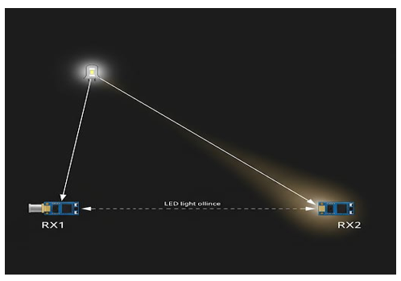
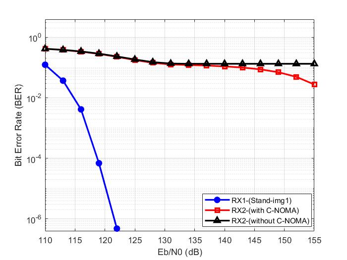
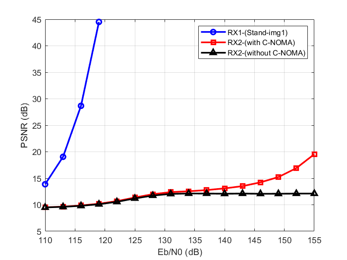
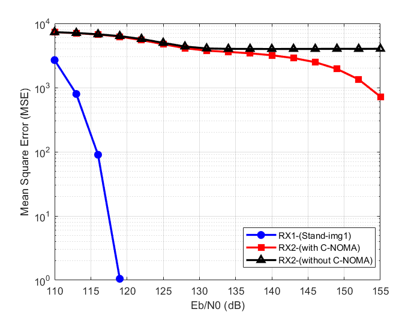
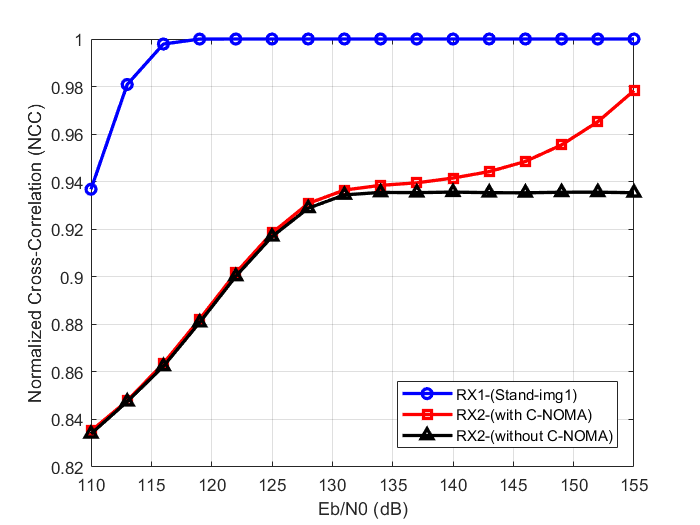
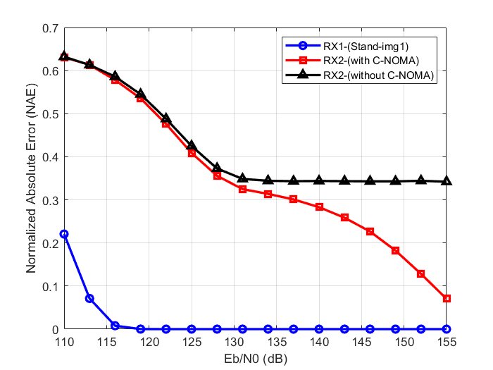
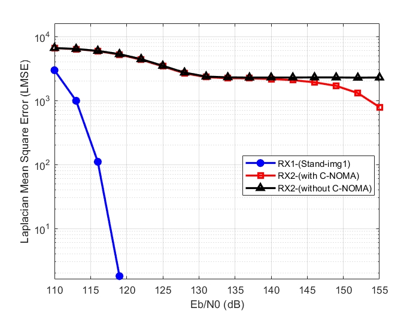
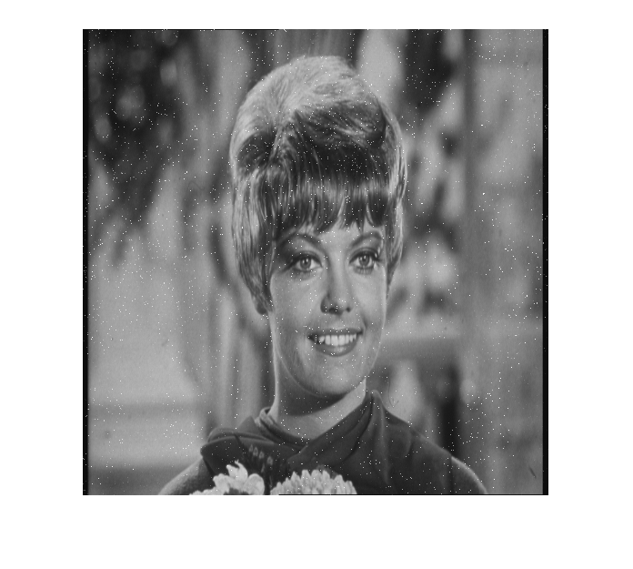

# On Image Transmission Using Cooperative NOMA in VLC Network

Visible Light Communication (VLC) uses LED lights to transmit data. In this
project, image data is transmitted using cooperative Non-Orthogonal Multiple
Access (NOMA) in a VLC network with On-Off Keying (OOK). Performance with and
without cooperation is compared using Maximum Ratio Combining (MRC).

**Tools used:** MATLAB, LaTeX
**Metrics evaluated:** BER, PSNR, MSE, NCC, NAE, LMSE

## Project Paper
[Click here to read the full paper (PDF)](Final_Submission.pdf)

## Experimental Setup

## Results

### BER

### PSNR

### MSE

### NCC

### NAE

### LMSE

## Received Images

---
*Source code is available on request.*
